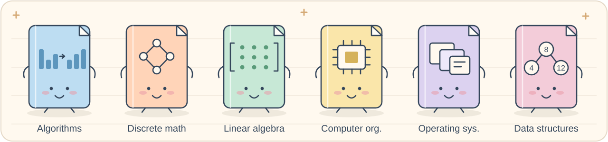
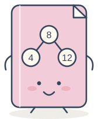
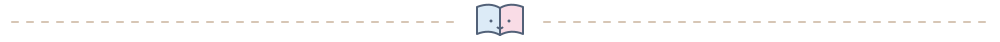

<h1 align="center">資訊工程與材料入門自學書架</h1>

繁體中文 · <a href="README.en.md">English</a>

<a href="#courses">📚 挑一科</a> · <a href="#materials">🔬 材料與元件</a> · <a href="#reading">✏️ 怎麼讀</a> · <a href="#references">📖 參考用書</a>

六科講義都放在這裡，有繁體中文和英文版。可以整本下載，也能按章節閱讀；每章的練習題和詳解分開放。

第一次來，可以先從分章目錄挑一章讀讀看，再決定要不要下載整本。

**選一條學習路線：** [補資訊工程基礎](#courses) · [CS 背景轉入 RRAM 與濺鍍](#materials)。材料課程目前提供繁體中文版。

## 六科小書架 📚

<table>
<tr>
<td width="50%" valign="top" align="left">
<h3> 演算法</h3>

排序、動態規劃、貪婪、圖演算法與複雜度

<a href="courses/algorithms/zh-TW/README.md">分章目錄</a> · <a href="courses/algorithms/zh-TW/complete-handout.pdf">中文整本</a> · <a href="courses/algorithms/en/complete-handout.pdf">英文整本</a>

</td>
<td width="50%" valign="top" align="left">
<h3> 離散數學</h3>

邏輯、計數、關係、圖論、代數與編碼

<a href="courses/discrete_mathematics/zh-TW/README.md">分章目錄</a> · <a href="courses/discrete_mathematics/zh-TW/complete-handout.pdf">中文整本</a> · <a href="courses/discrete_mathematics/en/complete-handout.pdf">英文整本</a>

</td>
</tr>
<tr>
<td width="50%" valign="top" align="left">
<h3> 線性代數</h3>

向量空間、正交投影、特徵值與 SVD

<a href="courses/linear_algebra/zh-TW/README.md">分章目錄</a> · <a href="courses/linear_algebra/zh-TW/complete-handout.pdf">中文整本</a> · <a href="courses/linear_algebra/en/complete-handout.pdf">英文整本</a>

</td>
<td width="50%" valign="top" align="left">
<h3> 計算機組織</h3>

指令集、處理器、快取與記憶體階層

<a href="courses/computer_organization/zh-TW/README.md">分章目錄</a> · <a href="courses/computer_organization/zh-TW/complete-handout.pdf">中文整本</a> · <a href="courses/computer_organization/en/complete-handout.pdf">英文整本</a>

</td>
</tr>
<tr>
<td width="50%" valign="top" align="left">
<h3> 作業系統</h3>

行程、執行緒、同步、排程與虛擬記憶體

<a href="courses/operating_systems/zh-TW/README.md">分章目錄</a> · <a href="courses/operating_systems/zh-TW/complete-handout.pdf">中文整本</a> · <a href="courses/operating_systems/en/complete-handout.pdf">英文整本</a>

</td>
<td width="50%" valign="top" align="left">
<h3> 資料結構</h3>

陣列與鏈結、樹與圖、雜湊及搜尋樹

<a href="courses/data_structures/zh-TW/README.md">分章目錄</a> · <a href="courses/data_structures/zh-TW/complete-handout.pdf">中文整本</a> · <a href="courses/data_structures/en/complete-handout.pdf">英文整本</a>

</td>
</tr>
</table>

## 材料與元件入門

新增 [RRAM 材料與濺鍍八週課程](courses/rram_materials/zh-TW/README.md)，從零電學開始，前兩週準備進場，第 3 週銜接受指導實驗。包含 [56 天課表與權重](courses/rram_materials/zh-TW/study-plan.pdf)、分章投影片、列印講義、獨立題解與實驗紀錄模板。

## 怎麼讀、怎麼印 ✏️

| 想怎麼讀 | 選哪種 PDF |
|---|---|
| 📖 一科從頭讀到底 | 完整版講義，含目錄、章節書籤和全書頁碼 |
| 🖨️ 列印、手寫筆記 | 分章講義版，A4 直式，上下兩張 |
| 🖥️ 用螢幕看或上課播放 | 教用播放版，16:9，一張一頁 |
| ✍️ 自己做題 | 先開練習題，做完再看獨立詳解 |

讀例題時，把中間步驟自己算一遍。遇到看不懂的圖，先找出每個節點、箭頭和顏色代表什麼，再對照推導。

### 讀書小路線 🧭

- **程式與解題**：基本程式設計 → [資料結構](courses/data_structures/zh-TW/README.md) → [演算法](courses/algorithms/zh-TW/README.md)。離散數學可搭配著補證明與計數。
- **電腦與系統**：[計算機組織](courses/computer_organization/zh-TW/README.md) → [作業系統](courses/operating_systems/zh-TW/README.md)。先弄懂指令和記憶體，再接行程、排程與虛擬記憶體。
- **數學**：[離散數學](courses/discrete_mathematics/zh-TW/README.md)與[線性代數](courses/linear_algebra/zh-TW/README.md)可各自安排進度，遇到需要的工具再回頭補。

## 參考用書 📖

📚 翻開書目與整理範圍

| 科目 | 參考用書 | 作者 |
|---|---|---|
| 演算法 | *Introduction to Algorithms*, 3rd Edition | Cormen, Leiserson, Rivest, Stein |
| 離散數學 | *Discrete and Combinatorial Mathematics*, 5th Edition | Ralph P. Grimaldi |
| 線性代數 | *Introduction to Linear Algebra*, 5th Edition | Gilbert Strang |
| 計算機組織 | *Computer Organization and Design*, Revised Fourth Edition | Patterson, Hennessy |
| 作業系統 | *Operating System Concepts*, 9th Edition | Silberschatz, Galvin, Gagne |
| 資料結構 | *Fundamentals of Data Structures in C++*, 2nd Edition | Horowitz, Sahni, Mehta |

資料結構依十一章主題綱要整理，未取得第二版全文供逐節核對。計組的參考 PDF 不含光碟附錄 C、D、E。其餘範圍說明在各科首頁。

原書與掃描檔不附在倉庫裡。每本完整版講義的首頁也有用書、作者與版次。

## 一起把筆記改好 🩹

錯字、算式有問題，或某張圖怎麼看都不懂，都可以[開一個 issue](https://github.com/xinhi6716/computer-science-self-study/issues)。附上科目、語言、章節和 PDF 頁碼，說明卡在哪一步，會比較容易查。

Lin Cing · [CC BY 4.0](LICENSE)。使用或改作時，請保留署名並連回本倉庫。

